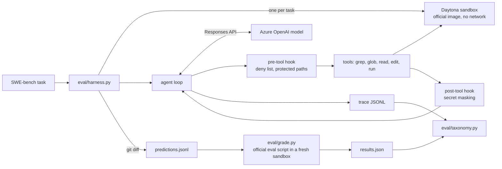

# mini-claude-code

**Solves 58.7% of SWE-bench Lite (176/300) at $0.004 per task with a single-agent loop**, graded with the official SWE-bench harness (one run, `gpt-6-luna`).

A small coding agent modelled on how Claude Code works: one model in a loop, five plain tools (grep, glob, read, edit, run), no vector index. Every SWE-bench task runs in its own [Daytona](https://daytona.io) sandbox built from the official SWE-bench image.

## Results

| | Value |
|---|---|
| Solved | **176 / 300 (58.7%)** |
| Model cost | $1.31 total, about $0.004 per task |
| Sandbox cost | under $1 of Daytona credit |
| Average steps per task | 17.8 |
| How runs ended | 292 final answer, 7 model API error, 1 token budget |

Repeat runs of the same tasks moved by 1–2 tasks per 50 (dev50: 33/50 alone, 31/50 inside the full run), so read the score as roughly 57–60%. Three of the failures are model API errors, not agent mistakes.

By project:

| Project | Solved | | Project | Solved |
|---|---|---|---|---|
| django | 78 / 114 | | astropy | 4 / 6 |
| sympy | 41 / 77 | | pylint | 3 / 6 |
| scikit-learn | 16 / 23 | | seaborn | 2 / 4 |
| matplotlib | 13 / 23 | | xarray | 2 / 5 |
| sphinx | 9 / 16 | | requests | 0 / 6 |
| pytest | 8 / 17 | | flask | 0 / 3 |

### Why tasks fail

One primary cause per failed run. Rule-based causes come from the trace and grading report (`eval/taxonomy.py`); the rest need a human to judge.

Full run, 124 failures:

| Cause | Tasks |
|---|---|
| Wrong file edited (no overlap with the real fix) | 22 |
| Patch broke other tests | 13 |
| Loop stopped (API error or budget) | 4 |
| Edit did not apply | 1 |
| Needs judgment (fix misunderstood or incomplete) | 84 |

The dev50 failures were labelled by hand: 6 underspecified issue, 4 incomplete fix, 3 wrong file, 2 wrong approach, 2 broke other tests. Most failures are the model misunderstanding the fix, not failing to find the code. Rerunning the 17 dev50 failures from scratch solved 0 of them, so they are consistent, not bad luck.

## What did not work

**A stricter "verify your fix" prompt.** Asked the agent to write a failing check before editing, cover related inputs and code paths, follow nearby conventions, and run the whole module's tests. The agent obeyed (it checked before editing on 50/50 tasks, up from 38/50, and ran 60% more commands after editing), but the score did not move: 32/49 both ways, excluding one sandbox crash, at 60% more cost. Its checks share the model's blind spots. Reverted.

**A code dependency graph (planned, not built).** The plan was a tree-sitter graph of calls, imports and tests, offered as extra tools beside grep. A pre-check on the 17 dev50 failures said it would barely help: in 14 the agent already edited every file the real fix touched; in the 3 wrong-file cases the right file was one import away, but in one the agent had already read it, and the other two are hub files (222 and 49 import neighbours) a graph would not single out. The 22 wrong-file failures in the full run are the place to test it if this is picked up again.

**Infrastructure lessons.**
- Daytona's free tier allows 10 sandboxes at once (10 vCPU / 10 GiB / 30 GiB). Killing a run leaves its sandboxes alive for 15 minutes; starting a new run on top went over the cap and showed up as "no IP address" and "sandbox not found" crashes.
- Daytona stops a sandbox after 15 minutes without SDK calls even while a command is running, which silently hung long sympy evals. Grading sandboxes now set a 45-minute idle stop.
- A laptop that sleeps pauses the run and its sandboxes get reaped. Runs are resumable for this reason.

## Architecture



| Folder | What it holds |
|---|---|
| `agent/` | The loop, state, tool-call parsing and execution |
| `mcp_server/` | The five tools and the workspace they run in (local or Daytona) |
| `hooks/` | Pre-tool policy (`config/policy.json`), protected paths, secret masking |
| `router/` | Azure client and per-token pricing |
| `sandbox/` | One Daytona sandbox per task |
| `trace_store/` | One JSONL trace per run: start, every step, end |
| `eval/` | Solve (`harness.py`), grade (`grade.py`), failure labels (`taxonomy.py`), fixed splits |
| `ui/`, `cli.py` | Interactive terminal app (Textual) |
| `config/` | Settings and every string and constant |

## Design decisions

- **Agentic search, not RAG.** Code has exact symbol names, an index is a stale copy of the code, and debugging is look, guess, look again. Claude Code dropped its vector index for grep for the same reasons.
- **Native tool calling, validated.** Every action is checked against its tool schema before it runs; a bad call goes back to the model as an error, never a crash.
- **Stop conditions in code, not the prompt.** Final answer, 100 steps, 1M tokens, $5, the same action three times in a row, or five invalid calls in a row. The stop reason is recorded on every run.
- **Edit by exact string replace.** The old text must match exactly once, or the edit fails loudly.
- **Policy as data.** Denied and ask-first commands live in `config/policy.json`; the hook enforces them and logs which rule fired.
- **One sandbox per task.** Built from the official SWE-bench image, network off for the agent, deleted afterwards. Grading uses a fresh sandbox with network, because the eval script reinstalls the repo.
- **Official grading only.** `eval/grade.py` runs each task's official eval script and scores it with `swebench.harness.grading.get_eval_report`. Scoring is never reimplemented.
- **Fixed splits.** `smoke10` and `dev50` (seeded sample) for iteration; the full 300 only for the final number.

## Running it

Needs Python 3.13, [uv](https://docs.astral.sh/uv/), an Azure OpenAI deployment and a Daytona API key.

```bash
uv sync
cp .env.example .env    # fill in the Azure and Daytona values
```

Interactive agent on the current folder:

```bash
uv run mclaude                 # terminal app
uv run mclaude -p "prompt"     # one prompt, print the answer
```

Benchmark (on macOS prefix with `SSL_CERT_FILE=$(uv run python -m certifi)`):

```bash
uv run python -m eval.harness  --batch my-run --split dev50 --workers 6   # solve; omit --split for all 300
uv run python -m eval.grade    --batch my-run --workers 4                 # official grading
uv run python -m eval.taxonomy --batch my-run                             # failure causes
```

Output lands in `runs/<batch>/`: a trace per task, `predictions.jsonl`, `results.json`, grading logs and `taxonomy.json`. Rerunning `harness` or `grade` with the same batch skips finished tasks, so a crash or a sleeping laptop costs nothing.

Keep workers at 6 or fewer on Daytona's free tier, and do not grade while a solve run is still going.

## Not built

From the original plan, left for later: the dependency graph and its ablation, an MCP wrapper around the tools, a Stop hook that sends the run back when no test was run, a two-tier model router, the prompt-injection experiment, history compression, and a trace viewer.

## Tests

```bash
uv run pytest
uv run ruff check .
```
